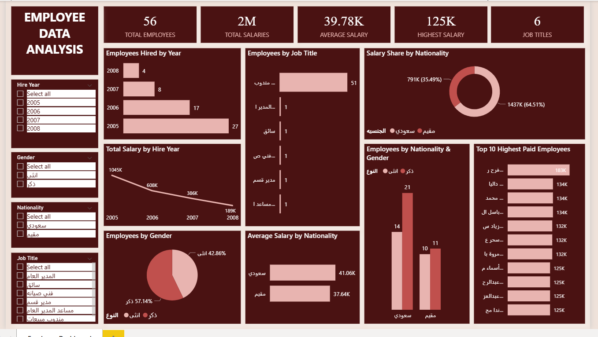

# Employee Data Analysis – Power BI Dashboard

An interactive HR dashboard built in **Power BI Desktop** that analyzes a company's employee records: headcount, salaries, hiring trends, nationality, gender and job titles.

## Key metrics (full dataset)

| KPI | Value |
|---|---|
| Total employees | 56 |
| Total salaries | 2.23M |
| Average salary | 39.78K |
| Highest salary | 125K |
| Job titles | 6 |

## What the dashboard shows

- **Employees hired by year** (2005 – 2008)
- **Total salary by hire year** – trend line
- **Employees by gender** – share of male / female employees
- **Employees by job title** – sales representatives are the largest group (51 of 56)
- **Average salary by nationality** and **salary share by nationality** (donut)
- **Employees by nationality & gender**
- **Top 10 highest-paid employees** (Top N filter on employee name)

## Insights

- 27 of the 56 employees (48%) were hired in 2005; hiring dropped every year after that (17 → 8 → 4).
- Saudi employees receive 64.5% of total salaries, and their average salary (41.06K) is higher than residents' (37.64K).
- Male employees are 57% of the workforce (32 male, 24 female).
- The company is sales-driven: 51 of 56 employees are sales representatives.
- Data quality note: some employee names appear more than once with different IDs, so the Top 10 chart (grouped by name) can show a total above the highest single salary (125K).

## Interactivity

Slicers on the left filter every visual by **hire year, gender, nationality and job title**.

## Tools & skills

- Power BI Desktop (data import from Excel, data modeling, date hierarchy)
- Visuals: KPI cards, bar / column / line / pie / donut charts, slicers, Top N filtering
- Custom report theme and layout design

## Files

| File | Description |
|---|---|
| `Employee Data Dashboard.pbix` | Power BI report |
| `data/employee_data.xlsx` | Source data (one sheet, 56 rows; column names are in Arabic) |
| `images/dashboard.png` | Dashboard screenshot |

## How to open

1. Install [Power BI Desktop](https://powerbi.microsoft.com/desktop/) (free).
2. Download or clone this repository.
3. Open `Employee Data Dashboard.pbix`. The data is already loaded in the file, so no refresh is needed.

## Author

**Hend Magdy** – [GitHub](https://github.com/hends3368-cpu) · [LinkedIn](https://www.linkedin.com/in/hend-magdy-196590363)
